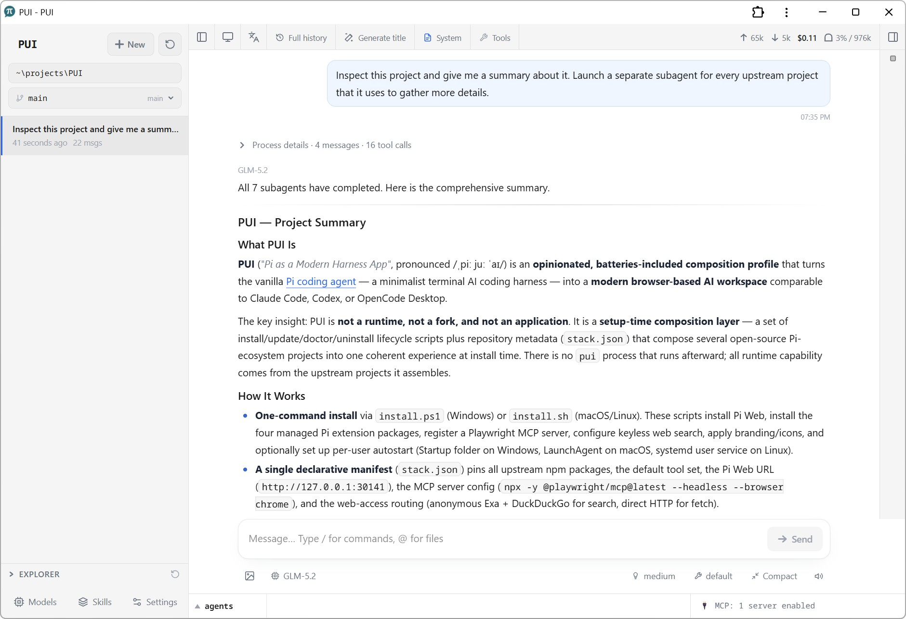

# PUI — Pi as a Modern Harness App

*/ˌpiː juː ˈaɪ/*

PUI turns the [vanilla Pi harness](https://github.com/earendil-works/pi) into a modern browser-based AI workspace, similar to Claude Code, Codex, or OpenCode Desktop. It adds a UI, web search, subagents, `/goal`, and more, all installed in one command.

Pi is a great harness, one of the most efficient on the market. But it's minimalistic by nature, so you don't get a desktop app experience out of the box. PUI solves this by composing open-source projects from the Pi ecosystem at setup time. It adds no PUI runtime process and does not maintain a Pi fork.

[](https://anbeeld.com/support)

## Features

- **Use Pi from a browser.** Pi Web provides the local GUI. PUI configures it at `http://127.0.0.1:30141` and can start it automatically for the current user.
- **App-like use via PWA.** Open PUI in a browser and install it as a PWA to use it like an application. This requires user action, so the installer can't do it automatically.
- **Search the web without API keys.** Search the web through anonymous Exa and DuckDuckGo with `web_search`, and fetch content directly over HTTP with `fetch_content`.
- **Collaborate across Pi Web sessions.** The Pi Web-only `session_list`, `session_get`, `session_send`, `session_start`, and `session_abort` tools discover sessions, exchange attributed task input, start background work, resume stopped sessions, and abort caller-owned work. Sending to or starting another session requires an explicit user request.
- **Resolve and constrain available models.** The `model_list` tool groups authenticated models by provider and returns each exact `provider/model-id`, context limits, capabilities, costs, and supported reasoning efforts. An optional fuzzy query can resolve names such as `gpt 6`. A model policy can allow or deny tools for an exact provider/model pair.
- **Parallelize work with subagents.** PUI routes code, Git, and PR inspection to *Explore*, external-source research to *Research*, and decided execution to *Worker*.
- **Drive the session toward a goal.** Keep work focused with a session-scoped `/goal` mode.
- **Ask before guessing.** Let the model ask structured questions with typed choices and optional free-form answers.
- **Switch between subscription accounts.** Use multiple accounts across supported OAuth providers.
- **Track token usage.** View usage and limits for the active provider on the current account with `/usage`, and toggle Codex Fast mode with `/fast`.
- **Run commands in the background.** Keep working while builds, tests, servers, or other long-running commands run. Check their output or interact with them when needed.
- **Find files and code fuzzily.** Locate files and code with fuzzy references, path resolution, and indexed content search.
- **Automate the browser with Playwright.** Headless Chrome automation that starts on demand.
- **Install and update as one profile.** PUI pins the component versions and checks for updates.



## Requirements

- Windows 10 or 11, macOS, or Linux
- Node.js 22.19.0 or newer (`node --version`)
- npm, which is bundled with Node.js
- Git
- `curl` on Linux
- Chrome for the configured Playwright MCP server
- systemd on Linux only when using the default autostart setup

PUI does not install Node.js, Git, or Chrome. When PWA integration is enabled, it creates a per-user autostart entry: a Startup-folder launcher on Windows, a LaunchAgent on macOS, or a systemd user service on Linux. The prerequisite check stops before setup if a required command is missing or Node.js is too old.

The background-tasks package includes `node-pty` prebuilt binaries for supported x64 and arm64 Windows, macOS, and Linux systems. If a compatible prebuild is unavailable, PUI's install/update entry point approves only `node-pty`'s lifecycle scripts and attempts a source rebuild; the required Python and C++ toolchain must then be present.

## Install

Open a terminal in this repository, then run the platform entry point. Or ask your agent to do so.

Windows (PowerShell):

```powershell
./install.ps1
```

macOS or Linux:

```bash
./install.sh
```

Before changing an existing JSON configuration file, the installer creates a timestamped backup. Invalid JSON stops setup safely. For JSON merges, unrelated settings are preserved and PUI manages only the fields and package entries described in [`stack.json`](stack.json).

### Options

| Option | Effect |
|---|---|
| `-NoPwa` / `--no-pwa` | Skip autostart and the browser app-setup page. Pi Web remains installed; start it manually with `pi-web`. |
| `-NoBrowser` / `--no-browser` | Configure autostart but do not open the app-setup page after installation. |
| `-KeylessRoute` / `--keyless-route` | Make PUI's keyless route primary when another primary search provider exists. The other provider remains configured after it. Without this option, the conflict stops installation for an explicit choice. |

## Update, diagnose, and uninstall

PowerShell:

```powershell
./update.ps1
./doctor.ps1
./uninstall.ps1
```

macOS or Linux:

```bash
./update.sh
./doctor.sh
./uninstall.sh
```

- **Update** uses the same transaction worker as the in-app **Install** action. It waits for Pi Web and standalone managed Pi work to become idle, applies exact managed versions from the tagged release, validates the result, and restores the previous certified release after a post-mutation failure. Model-catalog data may still refresh independently. If an update aborts after stopping Pi Web, its exit path reloads the service manager (or relaunches a manually started `pi-web`) and waits for HTTP 200 before returning. Stage and rollback output is kept at `~/.pi/agent/state/pui-update/last.log` with the latest status at `last-status.json`, so a failure stays diagnosable after a reboot.
- **Doctor** reads the installed update-extension identity, exact managed composition, Pi Web bridge, configuration, autostart, and health state without changing the installation. Missing or drifted managed MCP footer status is a failed diagnostic, not a warning.
- **Uninstall** removes the update extension only while its complete PUI-owned shape is intact, removes the owned Pi Web bridge, and restores original Pi Web assets. Autostart files are removed only when their complete canonical PUI content still matches; modified or unrecognized entries are preserved with a warning. Add `-Full` / `--full` to also remove managed packages, Pi Web, and standalone Pi. User projects, sessions, authentication, skills, and unrelated settings are preserved. A browser-installed PWA must be removed manually from the browser's app or shortcut settings.

Platform details are in [Windows](docs/windows.md), [macOS](docs/macos.md), and [Linux](docs/linux.md). The [component reference](docs/components.md) lists upstream components and repository structure; the [patch reference](docs/patches.md) documents managed files and ownership boundaries.

## Components

PUI is a setup and composition layer built on the work of other open-source projects. Its runtime capabilities come from the maintainers and contributors of the projects below. Thank you to everyone who builds, documents, reviews, and maintains them.

| Upstream project | Role in PUI |
|---|---|
| [`@earendil-works/pi-coding-agent`](https://github.com/earendil-works/pi) | Base Pi agent runtime used by the CLI and Pi Web |
| [`@agegr/pi-web`](https://github.com/agegr/pi-web) | Local browser GUI and PWA entry point |
| [`@gotgenes/pi-subagents`](https://github.com/gotgenes/pi-packages) | In-process subagent extension |
| PUI session communication | Pi Web-only `session_list`, `session_get`, `session_send`, `session_start`, and `session_abort` tools backed by the PUI-owned session broker |
| PUI model catalog | `model_list` discovery plus the shared exact-then-fuzzy resolver used by PUI model consumers |
| PUI model policy | Provider-grouped, exact-model capability policy; currently supports tool allowlists or denylists |
| [`pi-web-access`](https://github.com/nicobailon/pi-web-access) | Web search and direct HTTP fetching |
| [`pi-mcp-adapter`](https://github.com/nicobailon/pi-mcp-adapter) | MCP configuration and proxy integration |
| [`@playwright/mcp`](https://github.com/microsoft/playwright-mcp) | Browser automation through headless Chrome |
| [`@narumitw/pi-goal`](https://github.com/narumiruna/pi-extensions/tree/main/packages/pi-goal) | Session-scoped goal mode |
| [`@narumitw/pi-accounts`](https://github.com/narumiruna/pi-extensions/tree/main/packages/pi-accounts) | Named subscription OAuth account switching |
| [`@narumitw/pi-usage`](https://github.com/narumiruna/pi-extensions/tree/main/packages/pi-usage) | Provider usage and limits, and Codex Fast mode |
| [`@juicesharp/rpiv-ask-user-question`](https://github.com/juicesharp/rpiv-mono/tree/main/packages/rpiv-ask-user-question) | Structured questions and typed user choices |
| [`pi-fff`](https://github.com/ShpetimA/pi-fff) | Fuzzy file navigation and indexed content search |
| [`@99percentpeople/pi-background-tasks`](https://github.com/99percentpeople/pi-extensions/tree/master/extensions/background-tasks) | Background pipe/PTY tasks with attachable output; native `node-pty` dependency |

Please see each upstream repository for its license, contribution history, and project-specific terms.

## Patches

PUI owns the configuration and targeted patches that make its upstream components work as one reproducible application without a Pi fork. See the [patch reference](docs/patches.md) for exact files and ownership boundaries.

### Managed configuration

Each release pins its managed composition in [`stack.json`](stack.json). PUI structurally merges its owned values into most configuration files below. The reasoning-summary and session-title files are create-only: PUI writes defaults only when a file is missing and otherwise preserves a valid file byte-for-byte. The [patch reference](docs/patches.md) documents each lifecycle contract.

| File | PUI-owned fields |
|---|---|
| `~/.pi/agent/settings.json` | `defaultTools`, managed package entries, and explicitly retired package entries |
| `~/.pi/web-search.json` | `searchRouting`, `fetchRouting`, and `workflow` |
| `~/.config/mcp/mcp.json` | the Playwright server's `command`, `args`, `lifecycle`, and six-tool `directTools` policy, plus `settings.mcpFooterStatus` |
| `~/.pi/agent/pi-goal.json` | `continuationLimits.automaticTurns` and `continuationLimits.noProgressTurns` |
| `~/.config/rpiv-ask-user-question/config.json` | the `guidance.description`, `guidance.promptSnippet`, and `guidance.promptGuidelines` leaves |
| `~/.pi/agent/extensions/pi-fff.json` | `enabledFeatures`, with `agentTools` retired from it |
| `~/.config/pui/subagents.json` | `modelMappings` plus the `_pui.defaultMappings` reconciliation metadata |
| `~/.config/pui/reasoning-summaries.json` | Create-only per-model `auto`, `concise`, `detailed`, or `none` modes; new files default all three GPT-5.6 variants to `detailed` |
| `~/.config/pui/session-titles.json` | Create-only ordered exact-or-fuzzy title-model selectors; the active session model is always the final fallback |
| `~/.config/pui/model-policy.json` | Optional provider-grouped exact-model capability policies; a missing file is unrestricted, and each configured model may define one tool `allow` or `deny` list |
| `~/.pi/agent/npm/package.json` | the exact `node-pty` lifecycle-script approval, only when a native rebuild is required |

When PWA integration is enabled, PUI also installs one per-user Pi Web autostart entry (Startup-folder launcher on Windows, LaunchAgent on macOS, or systemd user service on Linux). In-place patches to installed package and Pi Web files are listed under **Code, build, and compatibility changes** below.

### Code, build, and compatibility changes

| Target | Why PUI changes it | PUI-owned change |
|---|---|---|
| `@narumitw/pi-goal` | Unlimited turns make upstream's status misleading, flattened command tokens destroy objective formatting, and terminal completion results otherwise remain inside collapsed process details. | Preserves line breaks, indentation, tabs, and repeated spaces in new goal objectives; uses `Goal: <status> · <reason> · <counter>` and omits the counter when turns are unlimited; replaces the 4,000-character summary cap with Pi's 50 KB UTF-8 boundary; and promotes the complete accepted summary into a durable `Goal complete` message that stays expanded both live and after reload and whose body alone uses Pi Web's compaction Markdown styling, without another model call. |
| `@gotgenes/pi-subagents` | Subagents should create substantial concurrency without outsourcing or duplicating the main critical path. | Defines background-default `Explore`, `Research`, and `Worker` with explicit tool sets; gives Explore unrestricted `bash` access for read-only code/Git/PR investigation (not a sandbox); delegates only distinct scoped deliverables when main has immediate non-overlapping work or at least two agents can run concurrently; names child-owned and excluded files, sources, and actions plus reserved main work; requires one owner per evidence question, main work before waiting, and parent revalidation only after collection; keeps sequential work, choices, verdicts, and sole-critical-path follow-ups in main; requires evidence for requested coverage, including relevant audit tests, and treats missing handoff fields, stopped, limit-steered, missing-coverage, and residual-work results as incomplete; propagates provider errors with partial output instead of false completion and rejects blank resolved responses; preflights tools and readable inputs; preserves authority/project instructions and one skill catalog; fails closed on unknown types; applies mapped models and inherited reasoning with explicit invocation precedence; bounds background capacity; delivers completions at the next parent turn, and projects a runtime-generated current-session ledger into model context so compaction cannot lose subagent IDs, statuses, collection state, reconciliation state, or next actions; and exposes `abort_subagent` for stopping one running or queued agent by retained ID. |
| PUI skill loader | Skill descriptions alone do not reliably cause every model to read applicable instructions before acting. | Installs a lightweight `load_skill` tool that loads an exact listed skill on demand, exposes only its direct Markdown reference filenames, and returns one or more selected references together with their parent skill when needed. Its constant base-system-prompt guidelines direct skill loading at task start and material phase changes, including matching parts of mixed tasks and required references; the per-turn hook contributes only the discovered skill catalog. |
| `@99percentpeople/pi-background-tasks` | Overlapping guidance obscures tool selection, module-global runtime state leaks across cached extension instances, and Pi Web otherwise evicts sessions that still own background tasks. | Replaces prompt/schema metadata with compact guidance, isolates mutable runtime state per extension instance, publishes session-scoped running-task activity for Pi Web's idle gate, and makes each PTY task's native teardown single-shot. |
| `node-pty` | PTY tasks fail when the packaged native binding cannot load, and repeated Windows ConPTY teardown can corrupt the host Node process. | Verifies the binding and, when needed, approves its lifecycle scripts and rebuilds it; the background-tasks compatibility patch prevents more than one native close per PTY task. |
| Responses reasoning summaries | Safe summary text should be generated at a user-selected detail level and remain readable without exposing raw reasoning or encrypted replay data. | Installs a request hook that applies exact provider/model overrides before bare model IDs for the three Responses adapters, defaults the three GPT-5.6 variants to `detailed`, treats `none` as omission, and never creates reasoning when it is off. The display patch trusts the parser-owned transient marker only in explicitly live projections, requires validated `summary_text` signatures elsewhere, renders entirely bold summaries as italics, returns stored provider thinking for non-Responses blocks in Pi Web's on-demand thinking route while untrusted Responses blocks stay empty, leaves stored messages unchanged, and transactionally rewinds failed cross-runtime snapshot restoration. |
| Automatic session titles | New sessions should receive useful compact names without delaying their main work or recreating a full agent. | Starts a detached title request from the first expanded user prompt, tries at most four configured exact-or-fuzzy model selectors in order with two provider retries, falls back to the active session model, requests no reasoning when supported, otherwise selects the model's lightest advertised reasoning level, and uses a 1,024-token ceiling plus a direct-prohibition prompt that requires the result inside strict `<pui-session-title>` markers. Only the final non-nested marked value is considered; prose outside the marker is ignored. The request remains one short JSON-framed user message with no system prompt or tools; input is capped at 600 Unicode code points; malformed multi-line, over-12-word, or over-80-code-point title output is rejected rather than truncated; generation cancels with the run, and any explicit or concurrent manual name—including a Pi Web sidebar rename—wins. |
| Pi Web goal-command display | pi-goal's internal prompts should not replace or temporarily remove the concise command the user entered. | Projects only strictly recognized initial and explicit-resume prompts as canonical `/goal …` and `/goal resume` text in Pi Web; retains an optimistic start, edit, or resume command until its generated goal turn or idle recovery becomes authoritative regardless of event order; and leaves stored prompts and model context unchanged. |
| Pi Web subagent notifications | Completion payloads should appear live without occupying transcript space until requested. | Reconciles persisted custom prompts on extension-started streaming reconnects, disarms that reload when a replayed user-message start identifies an ordinary UI run, and collapses `subagent-notification` cards to one tool-like row whose full accessible header toggles expansion; expanded content restores Copy and Details without changing other custom messages. |
| Pi #8782 | Pi 0.84.3 can cross the compaction threshold after a tool result but before the next provider request. | Backports only the upstream scheduling and between-turn compaction fix into Pi Web; standalone Pi remains stock. |
| Pi Web presentation | The app needs PUI identity and icons, while upstream's footer leaves excess widget space, its tool-call headers hide reference arguments, and the current session ID is buried in session details. | Applies branding and browser/PWA icons, versions affected caches, fixes the footer gap and duplicate border, shows `skill: references` in tool-call headers for reference loads, and adds a fixed-width ID-card **Copy ID** control immediately before **Full history**. Successful copies show **Copied!** for three seconds without resizing the toolbar. Peer task messages use the same compact typography as compaction and Goal complete content, and their JSON-encoded message body is decoded only for display so source line breaks render correctly. |
| Unix lifecycle scripts | Mounted Windows worktrees need directly runnable shell entry points under WSL and other Linux environments. | Keeps `install.sh`, `update.sh`, `uninstall.sh`, and `doctor.sh` on LF line endings through repository attributes and regression checks. |
| Pi Web updates | Pi Web's updater cannot safely update PUI's exact multi-package composition. | Adds PUI's update route, card, restart control, bridge, and inert identity extension; update-integration changes are transactional, installed updater files are hash-verified before code loads, Windows restart workers use the canonical hidden Startup VBS and verify recovery over HTTP, the requesting tab tolerates another tab consuming the one-shot completion status, completed restart status cannot suppress later discovery, and approved updates validate and roll back on failure. |
| Pi Web session communication and activity | Pi Web sessions need explicit, attributable collaboration without treating peer task input as user authority, and its idle gate must not shut down a session that still owns running background tasks. | Installs five Pi Web-only tools—`session_list`, `session_get`, `session_send`, `session_start`, and `session_abort`—through the PUI-owned server patch and sidecar, and extends the same exact-version server patch so session activity includes the owning background-task registry entry. `session_send` and `session_start` are used only after an explicit request from the current user, never merely because another session is available or work could be parallelized. Starts run in the background and queue a completion notification; stopped sessions resume. Model selectors are exact or fuzzy, and model/effort overrides are sent only when explicitly requested; effort falls to the nearest lower supported level. |
| PUI model catalog | Models need an exact installed identifier before passing an override to session or subagent tools. | Installs `model_list` and a versioned in-process resolver shared by model discovery, session titles, session communication, and subagents. Exact `provider/model-id` references win, ambiguous bare IDs and tied fuzzy winners are rejected for selection, stable aliases are preferred over dated variants, the newest dated variant wins when no alias exists, and reasoning-effort metadata follows Pi's model support rules. `model_list` reads Pi's authenticated availability snapshot and returns all ranked fuzzy matches with identity, API, context and output limits, capabilities, costs, pricing tiers, and supported effort names. |
| PUI model policy | Different models may require different capability boundaries. | Installs a generic provider-grouped model-policy extension. Its first capability controls tools with one exact-model `allow` or `deny` list. It removes prohibited tools and their tool-owned prompt metadata from subsequent model requests, reapplies restrictions after tool results, and blocks stale prohibited calls at execution time. Invalid policy disables tool execution until corrected; unrelated prompt text that mentions a tool is not rewritten. |

JSON changes use timestamped backups and preserve unrelated settings. The reasoning-summary and session-title files are never removed on uninstall and are never rewritten once valid. The optional model-policy file is likewise preserved when present; PUI neither creates it nor treats its absence as a failure. Version-anchored patches verify upstream shape after install and update; patch-specific backups and manifests expose drift and preserve user changes during rollback or uninstall. PUI-named autostart files are likewise removed only while their complete canonical content still matches.

## License

PUI is released under the [MIT License](LICENSE). Upstream components retain their own licenses.

## Looking for skills to add into PUI?

- [AGENTS.md: Evidence, Parallelization, Validation](https://github.com/Anbeeld/AGENTS.md)
- [WRITING.md: AI Writing Rules](https://github.com/Anbeeld/WRITING.md)
- [PROMPTING.md: AI Instruction Designer](https://github.com/Anbeeld/PROMPTING.md)
- [RESUME.md: AI Resume/CV Rules](https://github.com/Anbeeld/RESUME.md)

[](https://anbeeld.com/support)
